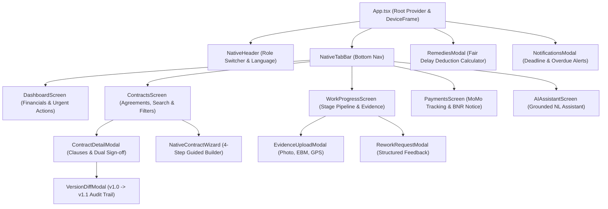

# IZERE Platform — React Native Implementation Plan & Architectural Blueprint

> **System Title:** IZERE (Contract Management, Work Progress, and Payment-Status Platform)  
> **Brand Tagline:** *Clear contracts. Visible progress. Accountable work. A better way to manage agreements.*  
> **Mobile Architecture:** React Native Cross-Platform Design System (`react-native-web` & Native Bridge)  
> **Visual Identity:** Modern African Fintech Theme — *Deep Forest Green + Warm Ivory + Sage + Warm Gold*  
> **Target Audience:** Engineering Team, Mobile Developers, Legal & Compliance Counsel, Project Evaluators.  
> **Core References:** *IZERE Comprehensive Project Proposal (October 2026)*; NISR Labour Force Survey (2024); BNR Law No. 61/2021; Rwanda Law No. 058/2021 (Personal Data Protection).

---

## 1. Executive Summary & Problem Context

### 1.1 The Rwandan Labor Landscape
Official data from the National Institute of Statistics of Rwanda (NISR) Labour Force Survey 2024 and FinScope 2024 highlights:
- **Informal Employment Dominance:** 90.4% of total employment in Rwanda is informal, with major clusters in market agriculture (48%), trade and repair services (15.6%), construction (11%), and transport/logistics (7.7%).
- **Financial Inclusion vs. Banking:** 96% of Rwandan adults are financially included, and 86% regularly use Mobile Money (MTN MoMo, Airtel Money); however, only 22% possess commercial bank accounts.
- **Critical Process Vulnerabilities:** Daily work agreements rely on fragile verbal promises, paper notes, or scattered WhatsApp chats:
  1. *Incomplete Terms:* Missing scope, undefined deliverables, unclear material procurement responsibilities.
  2. *Fragmented Records:* Conflicting drafts buried in message logs.
  3. *Zero Work Visibility:* Clients unsure whether a milestone is genuinely finished before releasing funds.
  4. *Weak Deadline Governance:* No agreed grace periods, leading to bitter disputes when unexpected rains or supply shortages hit.
  5. *Unstructured Changes:* Scope variations agreed verbally without signed change orders.
  6. *Portfolio Blindness:* Cooperatives and contractors managing 20+ simultaneous jobs with zero centralized oversight.

### 1.2 IZERE Positioning & Operational Scope
IZERE provides a **mobile-first shared record** linking agreement terms to physical work progress, verifiable photo/invoice evidence, deadline alerts, and mobile money payment references.

```
+---------------------------------------------------------------------------------------+
|                                WHAT IZERE IS NOT                                      |
|  • NOT a job marketplace (does not match unvetted workers or take gig commissions)     |
|  • NOT a court or law firm (does not deliver binding arbitration or judicial verdicts)|
|  • NOT a bank or unlicensed escrow custodian (holds ZERO customer funds)              |
|  • NOT an autonomous bot (AI never alters agreements or executes debits without human)|
+---------------------------------------------------------------------------------------+
```

---

## 2. Premium Fintech Design System & Design Tokens

### 2.1 Color Identity Rationale
- **Deep Forest Green (`#123D32`):** Primary brand anchor communicating stability, financial responsibility, and institutional trust.
- **Sage Green (`#E9F2EC`):** Soft contextual tint providing visual rhythm without harsh contrast.
- **Muted Emerald (`#397A61`):** Secondary accent for active states and positive progression bars.
- **Warm Gold (`#D5A85A`):** Premium accent highlighting certifications, ratings, and important actions.
- **Warm Ivory (`#F8F7F2`):** Welcoming background that avoids the clinical coldness of pure white while maintaining high readability on OLED/LCD screens in bright daylight.
- **Charcoal (`#202923`):** High-contrast typography avoiding pure black fatigue.

### 2.2 Design Tokens Definition (`src/theme/index.ts`)
```typescript
export const Colors = {
  light: {
    primary: "#123D32",       // Deep Forest Green
    primaryLight: "#E9F2EC",  // Sage Green
    secondary: "#397A61",     // Muted Emerald
    accent: "#D5A85A",        // Warm Gold
    background: "#F8F7F2",    // Warm Ivory
    surface: "#FFFFFF",       // Pure White Card Surface
    text: "#202923",          // Charcoal
    textSecondary: "#737D77", // Muted Slate
    border: "#E5E9E5",        // Soft Gray Border
    success: "#23845B",
    warning: "#B7791F",
    danger: "#C2413B",
    info: "#2563EB",
    cardMuted: "#F4F7F4",
  },
  dark: {
    primary: "#77B89A",
    primaryLight: "#203C32",
    secondary: "#8BC6A8",
    accent: "#D5B36F",
    background: "#101B17",
    surface: "#192720",
    text: "#F0F4F0",
    textSecondary: "#A0AEA5",
    border: "#304137",
    success: "#55B98A",
    warning: "#E5B75F",
    danger: "#F07870",
    info: "#76A9F5",
  },
};

export const Radius = {
  sm: 8,
  md: 12,
  lg: 16,
  xl: 20,
  full: 999,
};

export const Spacing = {
  xs: 4,
  sm: 8,
  md: 12,
  lg: 16,
  xl: 24,
  xxl: 32,
};
```

### 2.3 Status Color System
| Status | Background | Text / Border | Purpose / Meaning |
|---|---|---|---|
| **Draft** | `#F1F5F2` | `#737D77` | Initial contract preparation; only creator can edit |
| **In Review** | `#EFF6FF` | `#2563EB` | Counterparty examining proposed clauses |
| **Awaiting Confirmation** | `#FEF9EE` | `#B7791F` | Final version waiting for dual party signatures |
| **Active** | `#E9F2EC` | `#123D32` | Both parties confirmed; work in progress |
| **Awaiting Acceptance** | `#F0FDF4` | `#397A61` | Deliverable submitted for client inspection |
| **Completed** | `#ECFDF5` | `#23845B` | Handover finished; payment reference logged |
| **Disputed** | `#FEF2F2` | `#C2413B` | Active disagreement; all delay penalties frozen |
| **Overdue** | `#FFF1F2` | `#BE123C` | Milestone passed due date beyond grace period |
| **Expired** | `#F3F4F6` | `#6B7280` | Natural calendar expiry without renewal |

---

## 3. React Native Mobile Screens & Component Architecture



### 3.1 Screen Breakdown

#### 1. Dashboard Screen (`DashboardScreen.tsx`)
- **Role Greeting & Identity:** Displays current active persona (*Jean-Pierre Nsengimana* - Mason, *Diane Uwera* - Client, or *Kigali Artisans Coop* - Manager).
- **Financial Portfolio Overview:** Total portfolio value in RWF (e.g. RWF 12.9M), total collected, active contract counts, and pending signature alerts.
- **Quick Action Bar:** 4 one-tap actions (*Create Contract*, *Track Stages*, *MoMo Payment*, *Delay Calculator*).
- **Urgent Action / Dispute Card:** Highlights overdue work stages (e.g. Contract #IZ-2026-004) with direct access to remedies.
- **Active Contracts Stream:** Top agreements with progress bars, end dates, and RWF totals.
- **AI Assistant Teaser:** Deep Forest Green callout to query active contract terms.

#### 2. Contracts Screen (`ContractsScreen.tsx`)
- **Search & Unified Filtering:** Instant search across title, Kinyarwanda title, ID, and location.
- **Type Tabs (Proposal §4.2 & §4.3):**
  - *All Agreements*
  - *Short-Term Jobs:* Standalone jobs (roof repair, uniform tailoring, plumbing).
  - *Framework Master:* Umbrella agreements establishing rate cards and quarterly SLAs.
  - *Work Orders:* Discrete child tasks linked to framework contracts with inherited clauses.
- **Contract Detail Sub-View (`ContractDetailModal.tsx`):**
  - Parties dual confirmation cards with timestamps and phone numbers.
  - Scope and Rwandan translation.
  - Delay clause formula (Grace period, % daily penalty, % cap).
  - Digital confirmation sign-off flow with simulated SMS OTP.
  - Full version diff history comparing field changes between versions.

#### 3. Work Progress Screen (`WorkProgressScreen.tsx`)
- **Contract Legal Status vs. Work-Stage State (Proposal §5.2):** Strict visual separation between contract legal status and physical milestone progression.
- **Configurable Stage Pipeline:**
  - *Construction / Repair:* Planning → Procurement → Execution → Inspection → Handover.
  - *Digital / Tech:* Discovery → Design → Development → Testing → Deployment.
  - *Transport / Delivery:* Scheduled → Preparation → In Transit → Inspected → Accepted.
- **Evidence Upload Modal (`EvidenceUploadModal`):**
  - Simulated on-site photo proofs (roof membrane torching, certified tiles batch, electrical ATS switch).
  - EBM invoice receipt attachment.
  - Automatic Kigali GPS verification tag.
- **Review & Acceptance Actions:** Client can *Accept Deliverable*, *Request Correction / Rework* with feedback notes, or *Raise Formal Dispute*.

#### 4. Payments Screen (`PaymentsScreen.tsx`)
- **BNR Regulatory Disclosure (Law No. 61/2021):** Prominent educational banner explaining that IZERE does not operate unlicensed escrow or hold user money.
- **Financial Status Breakdown:** Agreed Total RWF vs. Paid to Date RWF vs. Remaining Balance.
- **Milestone Payment Schedule:** Clear indicators of Paid vs. Due Now vs. Pending Work.
- **Provider Reference Logging:** Record MTN Mobile Money (`*182#`), Airtel Money, or Bank of Kigali transaction reference codes (`MP261104.1432.A89211`) with receipt notes and provider-confirmed status.

#### 5. AI Assistant Screen (`AIAssistantScreen.tsx`)
- **Grounded Natural Language Query Engine:** Strictly bounded by user's authorized contract database (NIST Generative AI profile, Proposal §7).
- **5 Exact Proposal Queries Available as One-Tap Chips:**
  1. *"Show contracts that expired with unfinished work."*
  2. *"Which jobs are overdue this week?"*
  3. *"Which framework agreements expire next month?"*
  4. *"Summarise the changes to this contract."*
  5. *"How do I request an extension?"*
- **Source Citations & Interactive Links:** Every AI response cites the exact contract ID, status, and clause number with a one-tap button to open that record.

#### 6. Fair Delay Remedies Calculator (`RemediesModal.tsx`)
- **Proposal §6.2 Formula Implementation:**
  $$\text{Chargeable Days} = \max(0, \text{Days Late} - \text{Grace Days})$$
  $$\text{Raw Deduction} = \text{Chargeable Days} \times \text{Daily Rate \%} \times \text{Milestone Value}$$
  $$\text{Applied Deduction} = \min(\text{Raw Deduction}, \text{Max Cap Amount})$$
  $$\text{Net Payout} = \text{Milestone Value} - \text{Applied Deduction}$$
- **Required Safeguards:**
  - Mandates human review before any financial adjustment.
  - Immediately pauses all penalty calculations upon dispute filing.
  - Displays full calculation audit trail.

---

## 4. Relational Database Schema (PostgreSQL)

```sql
-- Users & Roles
CREATE TABLE users (
    id UUID PRIMARY KEY DEFAULT gen_random_uuid(),
    full_name VARCHAR(255) NOT NULL,
    phone_number VARCHAR(32) NOT NULL UNIQUE,
    national_id_or_tin VARCHAR(64),
    organization_name VARCHAR(255),
    role VARCHAR(32) NOT NULL DEFAULT 'worker', -- 'worker', 'client', 'cooperative'
    preferred_language VARCHAR(8) DEFAULT 'en',  -- 'en', 'rw'
    created_at TIMESTAMPTZ DEFAULT NOW()
);

-- Contracts & Frameworks
CREATE TABLE contracts (
    id VARCHAR(64) PRIMARY KEY, -- e.g. 'IZ-2026-001'
    contract_type VARCHAR(32) NOT NULL, -- 'short_term', 'framework', 'work_order'
    framework_id VARCHAR(64) REFERENCES contracts(id),
    title VARCHAR(255) NOT NULL,
    title_rw VARCHAR(255),
    category VARCHAR(64) NOT NULL,
    scope TEXT NOT NULL,
    scope_rw TEXT,
    work_location VARCHAR(255) NOT NULL,
    materials_provided_by VARCHAR(32) NOT NULL, -- 'contractor', 'client', 'shared'
    total_amount_rwf NUMERIC(12, 2) NOT NULL,
    start_date DATE NOT NULL,
    end_date DATE NOT NULL,
    status VARCHAR(32) NOT NULL DEFAULT 'draft',
    current_version VARCHAR(16) NOT NULL DEFAULT 'v1.0',
    grace_period_days INT DEFAULT 2,
    daily_penalty_pct NUMERIC(4, 2) DEFAULT 1.00,
    max_penalty_pct NUMERIC(4, 2) DEFAULT 5.00,
    clause_text TEXT NOT NULL,
    is_disputed BOOLEAN DEFAULT FALSE,
    dispute_reason TEXT,
    created_at TIMESTAMPTZ DEFAULT NOW(),
    updated_at TIMESTAMPTZ DEFAULT NOW()
);

-- Work Stages / Milestones
CREATE TABLE work_stages (
    id UUID PRIMARY KEY DEFAULT gen_random_uuid(),
    contract_id VARCHAR(64) REFERENCES contracts(id) ON DELETE CASCADE,
    stage_order INT NOT NULL,
    name VARCHAR(255) NOT NULL,
    name_rw VARCHAR(255),
    description TEXT,
    status VARCHAR(32) DEFAULT 'pending', -- 'pending', 'in_progress', 'in_review', 'completed', 'overdue'
    target_date DATE NOT NULL,
    completed_date DATE,
    assigned_party VARCHAR(255) NOT NULL,
    amount_rwf NUMERIC(12, 2) NOT NULL,
    evidence_required BOOLEAN DEFAULT TRUE,
    created_at TIMESTAMPTZ DEFAULT NOW()
);

-- Work Proof & Evidence
CREATE TABLE evidence_items (
    id UUID PRIMARY KEY DEFAULT gen_random_uuid(),
    stage_id UUID REFERENCES work_stages(id) ON DELETE CASCADE,
    title VARCHAR(255) NOT NULL,
    description TEXT,
    file_type VARCHAR(32) NOT NULL, -- 'image', 'receipt', 'document'
    file_url TEXT NOT NULL,
    uploaded_by UUID REFERENCES users(id),
    verified_by_client BOOLEAN DEFAULT FALSE,
    uploaded_at TIMESTAMPTZ DEFAULT NOW()
);

-- Phase-1 Payment Status Tracking
CREATE TABLE payment_records (
    id UUID PRIMARY KEY DEFAULT gen_random_uuid(),
    contract_id VARCHAR(64) REFERENCES contracts(id) ON DELETE CASCADE,
    stage_id UUID REFERENCES work_stages(id),
    amount_rwf NUMERIC(12, 2) NOT NULL,
    provider VARCHAR(64) NOT NULL, -- 'MTN Mobile Money', 'Airtel Money', 'Bank of Kigali'
    provider_reference VARCHAR(128) NOT NULL,
    status VARCHAR(32) DEFAULT 'provider_confirmed',
    reported_by UUID REFERENCES users(id),
    receipt_notes TEXT,
    created_at TIMESTAMPTZ DEFAULT NOW()
);

-- Immutable Version & Audit History
CREATE TABLE contract_audit_events (
    id UUID PRIMARY KEY DEFAULT gen_random_uuid(),
    contract_id VARCHAR(64) REFERENCES contracts(id) ON DELETE CASCADE,
    actor_id UUID REFERENCES users(id),
    action_type VARCHAR(64) NOT NULL, -- 'CREATED', 'CONFIRMED', 'EVIDENCE_UPLOADED', 'STAGE_ACCEPTED', 'DISPUTE_RAISED'
    version_affected VARCHAR(16),
    payload JSONB,
    timestamp TIMESTAMPTZ DEFAULT NOW()
);
```

---

## 5. Regulatory Compliance & Ethical Governance

### 5.1 Rwanda Law No. 058/2021 (Personal Data Protection)
1. **Data Minimisation:** The registration and agreement wizard collect only essential contact details (name and phone number). National identification numbers and TINs are strictly optional.
2. **Access Control:** Row-level security restricts contract visibility strictly to confirmed counterparties.
3. **Data Subject Rights:** Users can inspect version change histories and request audit trail exports.

### 5.2 National Bank of Rwanda (BNR) & Law No. 61/2021 Compliance
- **Zero Escrow Risk:** IZERE does NOT hold customer funds, escrow balances, or intermediate payout settlements.
- **Phased Strategy:**
  - *Phase 1 (Current):* External transaction reference logging, receipt reconciliation, and status verification.
  - *Phase 2:* Direct API integration with licensed telecom aggregators for automated SMS callback verification.
  - *Phase 3:* Regulated escrow or payment holding only if approved under BNR sandbox licensing with licensed commercial banking partners.

### 5.3 NIST Generative AI Guardrails & Ethical Rules
- **Anti-Hallucination:** The AI Contract Assistant operates in read-only retrieval-augmented mode over the user's relational database records.
- **Zero-Action Principle:** AI cannot silently edit contracts, accept deliverables, calculate penalizing debits, or waive grace periods without human sign-off.
- **Dispute Freeze:** When either party registers a dispute, all automated penalty timers and delay calculations are automatically suspended.

---

## 6. Phased Implementation Roadmap & Kigali Pilot

```
+---------------------------------------------------------------------------------------+
|  Phase A: Requirements & Legal Validation                                             |
|  - Validate contract wording with Rwandan commercial counsel in Kigali                |
|  - Confirm pilot use cases: residential repairs & small construction in Kigali        |
+---------------------------------------------------------------------------------------+
                                           |
+---------------------------------------------------------------------------------------+
|  Phase B: React Native Contract & Progress MVP (Current System)                       |
|  - Full React Native design system (Deep Forest Green, Warm Ivory, Slate)             |
|  - Guided templates, short-term contracts, framework master + work order inheritance  |
|  - Work-stage pipeline, photo evidence upload, rework request modal                   |
+---------------------------------------------------------------------------------------+
                                           |
+---------------------------------------------------------------------------------------+
|  Phase C: Notifications & Fair Delay Engine                                           |
|  - Automated 7-day and 24-hour milestone deadline countdowns                          |
|  - Transparent indicative delay deduction calculator with human review checks         |
+---------------------------------------------------------------------------------------+
                                           |
+---------------------------------------------------------------------------------------+
|  Phase D: Grounded AI Contract Assistant                                              |
|  - Natural language retrieval over permitted contract records with source citations  |
+---------------------------------------------------------------------------------------+
                                           |
+---------------------------------------------------------------------------------------+
|  Phase E: Controlled Kigali Pilot (6–8 Weeks)                                         |
|  - 20–30 matched artisan-client pairs across Gasabo and Nyarugenge                    |
|  - Track contract completeness, confirmation speed, on-time milestones                |
+---------------------------------------------------------------------------------------+
```

### 6.1 Pilot Key Performance Indicators (KPIs)
| KPI | Target | Measurement Method |
|---|---|---|
| **Contract Completeness** | $\ge 95\%$ | Share of created agreements with all mandatory fields completed via guided templates |
| **Mutual Confirmation Rate** | $\ge 85\%$ | Share of agreements digitally confirmed by both parties within 48 hours |
| **On-Time Milestone Rate** | $\ge 80\%$ | Milestones completed on or before agreed target date |
| **Dispute Resolution Speed** | $\le 72\text{ hours}$ | Average duration to record an amicable resolution or extension |
| **AI Retrieval Accuracy** | $100\%$ | Grounded answers without hallucinated terms on standard evaluation test set |

---

## 7. Risk Register & Mitigations

| Risk | Likelihood | Impact | Technical & Operational Mitigation |
|---|---|---|---|
| **Informal Workers Hesitant to Adopt Digital App** | Medium | High | Bilingual interface (English & Ikinyarwanda); ultra-clean fintech design; minimal form fields; SMS fallback alerts. |
| **Disputed Delay Penalties** | Medium | Medium | Agree on grace periods upfront (default 2 days); transparent daily calculation; human review mandatory; pause deductions on dispute. |
| **AI Hallucinations / Legal Liability** | Low | High | Restrict assistant to read-only database retrieval; cite exact record IDs; forbid AI from altering legal terms. |
| **Regulatory Breach on Payment Escrow** | Medium | Critical | Strictly maintain Phase 1 non-custodial model; display BNR Law 61/2021 notice; record only external references. |
| **Site Connectivity Dropouts** | High | Medium | Full offline local caching with automatic background synchronization upon network recovery. |

---

*Authored for the IZERE Platform Project Evaluation & Engineering Deployment (2026).*
